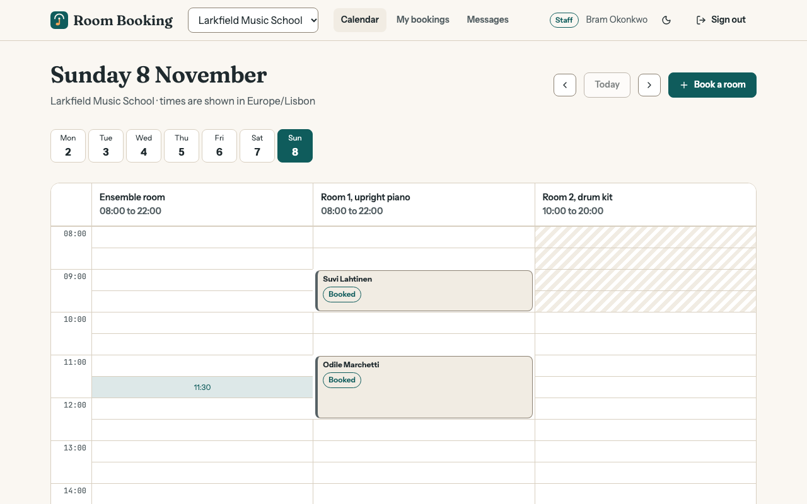

# Room Booking

Rehearsal room booking for a fictional music school: a Ruby on Rails GraphQL API with a typed React front end.

[](https://github.com/Nawfaldev19/rails-graphql-room-booking/actions/workflows/ci.yml)
[](LICENSE)



> **About this screenshot.** It shows the seeded demo data. To take it again after a
> design change: run `bin/demo`, open <http://localhost:3400>, choose "Continue as
> staff", set the browser window to 1280 × 800, and save the visible page as
> `docs/screenshots/calendar.png`.

Room Booking is a portfolio demo, not a product. Everything in it is fictional: the
schools, the people and the bookings.

## What this demonstrates

1. **A rule that holds under concurrency.** Two bookings of one room can never
   overlap, because database triggers refuse it, whatever the application does. See
   [`src/api/db/migrate/20250101000000_create_schema.rb`](src/api/db/migrate/20250101000000_create_schema.rb),
   proven with real threads in
   [`src/api/spec/services/bookings/overlap_spec.rb`](src/api/spec/services/bookings/overlap_spec.rb).
2. **Tenant isolation in the data layer that fails closed.** Every tenant model is
   scoped to the current workspace and raises when none is set. See
   [`src/api/app/models/concerns/tenant_scoped.rb`](src/api/app/models/concerns/tenant_scoped.rb)
   and [`src/api/spec/models/tenancy_spec.rb`](src/api/spec/models/tenancy_spec.rb).
3. **Time handled correctly.** Opening hours and weekly limits are wall-clock rules
   in each school's time zone and stay right when the clocks change, on the server
   and in the browser. See
   [`src/api/app/services/bookings/rules.rb`](src/api/app/services/bookings/rules.rb)
   and [`src/web/lib/time.ts`](src/web/lib/time.ts).
4. **Notifications designed as a system.** Templates with validated merge tags, a
   hand-written iCalendar file, signed unsubscribe links, and a token-bucket rate
   limit that queues instead of dropping. See
   [`src/api/app/services/notifications/`](src/api/app/services/notifications/) and
   [`src/api/app/services/rate_limiting/token_bucket.rb`](src/api/app/services/rate_limiting/token_bucket.rb).
5. **A GraphQL API in idiomatic Rails.** Thin resolvers over service objects, batched
   loading with no N+1 queries, policies that also drive the buttons the interface
   shows. See [`src/api/app/graphql/`](src/api/app/graphql/) and
   [`src/api/app/services/bookings/`](src/api/app/services/bookings/).
6. **A typed React front end on the same design system as my other demos.** A
   calendar that is a grid on a wide screen and a list on a phone, with operation
   types inferred from the Rails schema. See
   [`src/web/features/calendar/`](src/web/features/calendar/) and
   [`src/web/graphql/operations.ts`](src/web/graphql/operations.ts).

## Quick start

You need [Ruby](https://www.ruby-lang.org) 3.3 and [Node.js](https://nodejs.org)
20.19 or newer. The database is SQLite, so there is nothing else to install.

```bash
bin/demo
```

This installs the packages and gems, builds the web app, creates the database with
demo data and starts the server. Then open <http://localhost:3400>. The start page
explains the demo and signs you in with one click.

| Demo account | Email               | Password        | Can                                                              |
| ------------ | ------------------- | --------------- | ---------------------------------------------------------------- |
| Admin        | `odile@example.com` | `practice-demo` | Everything, and is a student at a second school                  |
| Staff        | `bram@example.com`  | `practice-demo` | Book, move, cancel and check in for anyone; read the message log |
| Student      | `suvi@example.com`  | `practice-demo` | Book rooms for herself                                           |
| New student  | `teo@example.com`   | `practice-demo` | Book, after giving two details once                              |

Things to try: book a slot as the student, then sign in as the new student and see
the same slot as "Taken" with no name. As staff, cancel it with a reason and open
**Messages**. As admin, open **Settings**, rename a status and edit a message with
the live preview.

Demo bookings are placed around the day the database was created. Run
`bin/demo --reset` to start again from fresh data.

### Other commands

| Command                             | What it does                                                                         |
| ----------------------------------- | ------------------------------------------------------------------------------------ |
| `npm run dev`                       | Rails on port 3400 and the web app with hot reload on port 5174                      |
| `npm run check`                     | Web: lint, type check, unit and component tests with coverage, build                 |
| `cd src/api && bundle exec rspec`   | API: all specs, with a coverage report                                               |
| `cd src/api && bundle exec rubocop` | API: lint                                                                            |
| `npm run test:e2e`                  | Browser tests against the real server (first run: `npx playwright install chromium`) |
| `npm run codegen`                   | Rewrite `schema.graphql` and the client's schema types after an API change           |
| `docker compose up --build`         | Run the production build in a container on port 3400                                 |

If Playwright has no browser build for your operating system, run the browser tests
with an installed Chrome instead: `PW_CHANNEL=chrome npm run test:e2e`.

## Project layout

```
src/api     the Rails application (models, services, GraphQL, specs)
src/web     the React application
tests       web unit and component tests, and the end-to-end tests
docs        architecture, decisions, testing, security, references
```

## Tech stack

| Choice                                        | Why                                                                                                |
| --------------------------------------------- | -------------------------------------------------------------------------------------------------- |
| Ruby on Rails 8.1, API mode                   | Conventions for the parts that are ordinary, so the code can concentrate on the parts that are not |
| graphql-ruby                                  | One typed endpoint; its built-in dataloader batches lookups                                        |
| SQLite                                        | No database to install; triggers and composite foreign keys still enforce the rules                |
| Active Job                                    | The outbox retries on its own schedule without another service                                     |
| React 19 with React Router, TypeScript strict | The same front-end stack as my other demos, for a consistent comparison                            |
| urql with gql.tada                            | Operation types inferred from the Rails schema file, with no generated operation code              |
| Plain CSS with custom properties              | The shared design tokens stay visible and the licence list stays short                             |
| RSpec, Vitest, Testing Library, Playwright    | Each layer tested with the tool its ecosystem expects                                              |

## Documentation

- [Plan](docs/PLAN.md): goals, scope and the order the work was done in
- [Architecture](docs/ARCHITECTURE.md): the parts, the data model, tenancy and the main flows
- [Decisions](docs/DECISIONS.md): nine architecture decision records with the alternatives that were rejected
- [Testing](docs/TESTING.md): what each test layer covers, coverage numbers and known gaps
- [Security](docs/SECURITY.md): threat model, controls, and what is deliberately not covered
- [References](docs/REFERENCES.md): specifications, documentation and books behind the patterns used

## Scope and limitations

- **No email leaves the server.** "Sent" means the message reached the delivery log,
  which staff can read under **Messages**. The place where a mail service would be
  called is one method.
- **No reminders.** Messages are sent for a new booking, a change and a
  cancellation. A reminder before a booking would need a scheduler, which this demo
  leaves out.
- **Rooms and people come from seed data.** There are no screens for adding rooms,
  inviting people or changing roles.
- **Jobs run inside the web process** (Rails' async adapter). They are lost on a
  restart; queued messages are not, because the queue is a database table and can be
  sent again from the **Messages** page.
- **SQLite allows one writer at a time.** That is what makes the overlap triggers
  race-free here, and it is also the scaling limit. ADR 2 describes what would change
  on Postgres.
- **Sign-in attempts are limited per process**, in memory. The mail limit is in the
  database and is shared.
- **The calendar grid is long to tab through.** Every free slot is a button. The
  "Book a room" button opens the same dialog with selects, which is the short way by
  keyboard.
- **The container setup is not covered by CI.** `Dockerfile` and `docker-compose.yml`
  are provided for convenience; `bin/demo` is the tested path.

## Author

Nawfal Imran · [GitHub](https://github.com/Nawfaldev19) · [LinkedIn](https://www.linkedin.com/in/nawfal-imran-886b13218)

## License

[MIT](LICENSE). Third-party packages and fonts are listed in
[THIRD_PARTY_NOTICES.md](THIRD_PARTY_NOTICES.md).
