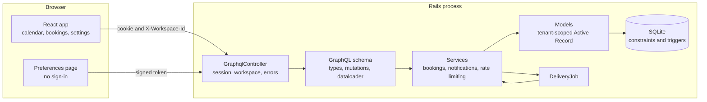
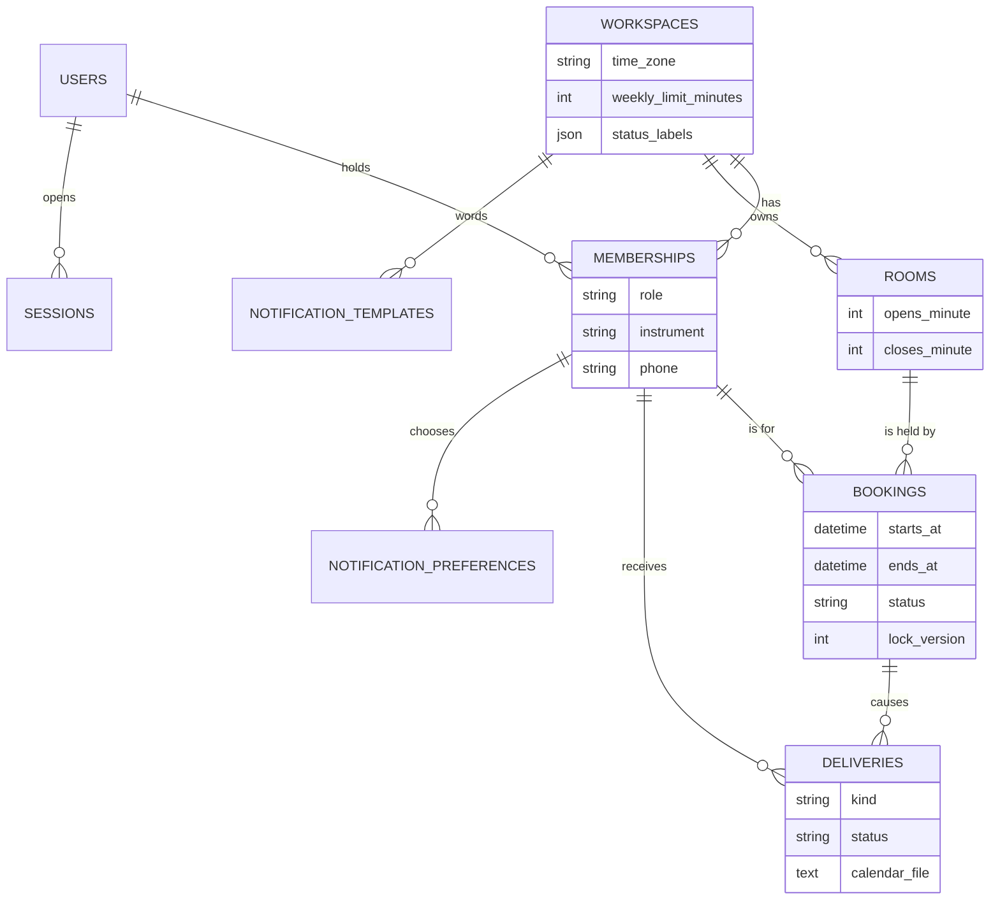
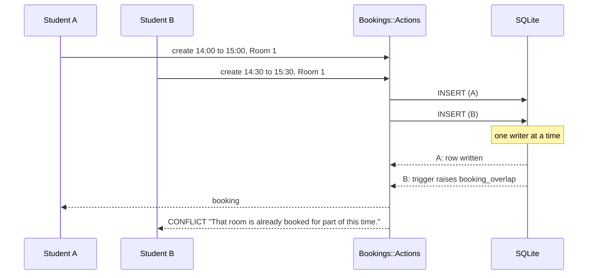
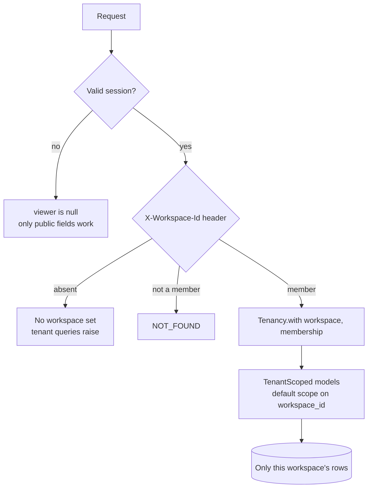
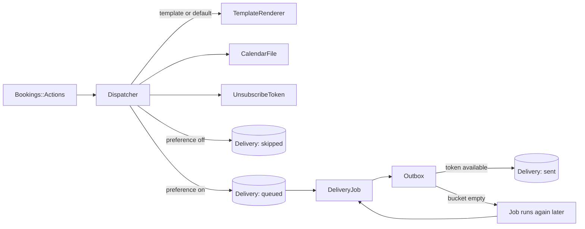

# Architecture

## The parts

One Rails process serves the GraphQL API and the built web app. The browser talks
to the server only through `POST /graphql`.



## Layers on the server

| Layer      | Folder            | Responsibility                                                                                                      |
| ---------- | ----------------- | ------------------------------------------------------------------------------------------------------------------- |
| Controller | `app/controllers` | Find the user and the workspace, run the operation inside that workspace, turn unexpected errors into a safe answer |
| GraphQL    | `app/graphql`     | Shapes, arguments, access guards and batching. No business rules                                                    |
| Services   | `app/services`    | Use cases and rules. Plain Ruby objects, called by GraphQL, jobs and seeds alike                                    |
| Models     | `app/models`      | Persistence, validation of single records, and tenant scoping                                                       |
| Database   | `db/migrate`      | What must hold whatever the code does: foreign keys, checks, triggers                                               |

Booking logic is split three ways on purpose:

- `Bookings::Rules` answers "is this booking allowed?" from values passed in. The
  current time is an argument, so every rule has a direct test.
- `Bookings::Policy` answers "may this person do this to that booking?". The API uses
  the same object to fill `canCancel`, `canReschedule` and the other flags, so the
  buttons on screen and the checks on the server cannot disagree.
- `Bookings::Actions` performs a change: permission, rules, write, notification. It
  also translates what the database may refuse into errors with stable codes.

## Data model



Points worth noticing:

- **Times are stored in UTC.** Opening hours are stored as minutes after local
  midnight, and each workspace has an IANA time zone. Wall-clock rules are applied by
  converting the UTC instant into that zone at the moment of the check.
- **Child tables point at their parent with `(workspace_id, id)`.** The database
  refuses a booking that joins one school to another school's room or person.
- **A booking's status holds the room or it does not.** `booked` and `checked_in`
  hold it; `cancelled` and `missed` do not. The overlap triggers look only at the
  first two, so a cancelled slot is free again at once.
- **There is no schema file.** The Ruby schema format cannot express triggers, and
  the SQL format needs the SQLite command-line tool to load. With one migration,
  replaying it is instant.

## How overlap is prevented



A `BEFORE INSERT` trigger and a `BEFORE UPDATE` trigger look for another active
booking of the same room whose time range intersects the new one, and abort the
statement if there is one. The application does not check first: a check followed by
a write can be raced, and the trigger cannot. The web app offers only free slots, as
a convenience; when two people pick the same one, the second is told and their
calendar reloads.

## Tenancy model



`Tenancy.with(workspace) { ... }` makes one workspace current for a request or a
job. Models that include `TenantScoped` then:

- read only that workspace's rows, through a default scope;
- raise `Tenancy::NotSet` if no workspace is current, instead of reading everything;
- are created in the current workspace, and cannot be saved into or moved to another.

`Membership` is the one bridge model without the scope. It is reached through a user
(to list their schools) or through the current workspace, never on its own.

The web app uses one GraphQL client per workspace. Each sends its workspace id in a
header and has its own cache, so data cached for one school cannot be shown under
another.

## Notifications



Every booking event writes a delivery row, whether or not it will be sent. A message
that a person opted out of is logged as skipped with the reason, so staff can answer
"why did they not hear about it?".

The outbox takes one token per message from a token bucket kept in the database.
When the bucket is empty it stops, leaves the rest queued, and the job schedules
itself for when the next token is due. Nothing is dropped, and a restart loses no
message because the queue is a table.

## Performance reasoning

- **No N+1 queries.** A day of bookings needs each booking's room and, for staff,
  the person's name. Both go through graphql-ruby's dataloader, one query each. A
  request spec loads six bookings and then twelve and asserts that the query count is
  the same.
- **Bounded queries.** The calendar query refuses a period longer than 31 days.
  Schema limits cap query depth and complexity. The delivery log pages by key
  `(created_at, id)`, not by offset.
- **Indexes match the questions asked:** `(workspace_id, starts_at)` for the
  calendar, `(room_id, starts_at)` for the overlap triggers,
  `(workspace_id, membership_id, starts_at)` for a person's week, and
  `(workspace_id, created_at)` for the delivery log.
- **The page is small to change.** The calendar loads one week at a time and moves
  between days without a new request.

## Error handling

Services raise `ApiError` with a stable code (`VALIDATION`, `CONFLICT`,
`FORBIDDEN`, `NOT_FOUND`, `UNAUTHENTICATED`, `RATE_LIMITED`, `PROFILE_INCOMPLETE`)
and a list of issues, each naming the input it concerns. The schema passes these to
the client in `extensions`. Anything else is a bug: the controller logs it and
answers with a generic message and status 500.

The web app puts issues next to the inputs they name and shows only general failures
in a banner. `PROFILE_INCOMPLETE` is handled as a step, not an error: the dialog
shows the two missing inputs and retries the booking.

## Web app structure

```
src/web
  styles/       tokens.css (design tokens), base.css, components.css
  graphql/      the client factory and every typed operation
  lib/          time-zone arithmetic, error reading, hooks, theme
  components/   presentation only: buttons, fields, dialog, toasts, badges
  features/     auth, shell, landing, calendar, bookings, outbox, settings, preferences
```

Two modules hold the logic that is worth testing without a browser:

- `lib/time.ts` converts between UTC instants and wall-clock time in a named zone
  using only the `Intl` API, including on days when the clocks change.
- `features/calendar/calendar-model.ts` places bookings on the grid and works out
  free slots and possible lengths.
